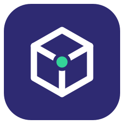
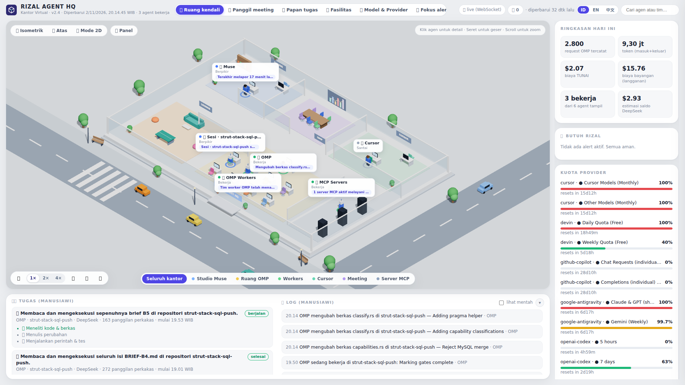

<p align="center">
  
</p>

<h1 align="center">Rizal Agent HQ</h1>

<p align="center">
  <b>A 3D headquarters for every AI agent that works for you.</b><br>
  One room, every agent visibly at work — with <i>human-friendly</i> tasks &amp; logs,<br>
  per-agent usage, and alerts whenever someone <i>needs you</i>.
</p>

<p align="center">
  
  
  
  
  
</p>

---

<p align="center">
  
</p>
<p align="center"><i>The 3D office running on real data — OMP, Cursor, and Muse in the front row; robot workers &amp; MCP behind them; Critical alerts and provider quotas in the right-hand panel.</i></p>

## ✨ Why does this project exist?

Modern AI agents no longer work alone: there's a main assistant, a multi-provider
coding engine, subagents spawned on demand, an AI editor, MCP servers — all
running at the same time, and their owner **can't see any of it**. Terminals are
full of raw logs, token costs are scattered everywhere, and nobody tells you
when an agent has been silently waiting for your decision for two hours.

**Rizal Agent HQ** turns all of that into one **living 3D office**:

| | |
|---|---|
| 🏢 **Per agent, not per machine** | What you see is *who is working*: every agent & worker has its own desk, character, and status. Machines (WSL/Docker/Git) are just supporting panels. |
| 🧑‍🤝‍🧑 **Mixed characters** | Main agents = low-poly humans; workers & MCP = small robots in their parent's colors. One glance tells you who's a permanent employee and who's an on-call contractor. |
| 🗣️ **Human-friendly logs & tasks** | Not `bash -c CARGO_BUILD_JOBS=2 cargo test …`, but *"OMP is running the strut-stack-sql test suite — 188 tests green."* The raw log is still there, behind a toggle. |
| 👆 **A real detail view** | Click a character → a 5-tab detail view: Summary, Tasks, Log, Usage, Sessions & Files. |
| 🚨 **"Needs You" alerts** | A full quota, a dwindling balance, an agent dying unexpectedly, a session waiting for input — all surface as tiered alerts, and **Critical** ones are forwarded to WhatsApp. |
| 💸 **Honest per-agent costs** | Tokens & costs are attributed per agent/session, always split into **CASH vs shadow** (subscription). No more unexplained "total $16" that belongs to no one. |
| 🔌 **Dynamic & plug-and-play** | Data sources live in a registry: adding a new connector takes one function + one line. External agents can join the office with a simple heartbeat POST. |

## 🚀 Install (plug & play)

You need: Linux with `systemd --user`, Rust (to build), and that's it.
OMP/Cursor/other agents are **optional** — whatever isn't there shows as
*Offline*, and everything else keeps running.

```bash
git clone https://github.com/rzlco666/rizal-agent-hq.git
cd rizal-agent-hq
./scripts/install.sh
```

Done. Open **http://localhost:8900/** — your 3D office fills up straight from
your own machine. Remove it any time with `./scripts/uninstall.sh`.

Run it manually, without systemd:

```bash
cargo run --release -p hq-server      # http://127.0.0.1:8900/
cargo test --workspace                # 13+ tests
```

## ⚙️ Configuration (all via env, no mandatory files)

| Env | Default | Meaning |
|---|---|---|
| `HQ_PORT` | `8900` | Server port |
| `HQ_BIND` | `127.0.0.1` | Listen address |
| `HQ_INTERVAL` | `30` | Data collection interval (seconds) |
| `HQ_DATA` | `data/` | Folder for SQLite + heartbeats |
| `HQ_WEB` | `web/` | Static UI folder |
| `HQ_SOURCES` | *(all)* | Source allowlist, e.g. `omp,cursor,Muse` |
| `HQ_DISABLE_SOURCES` | — | Disable specific sources, e.g. `mcp` |

## 🧩 Dynamic: adding new agents & connectors

Three paths, as deep as you need — the full guide is in
**[docs/ADDING-A-SOURCE.md](docs/ADDING-A-SOURCE.md)**:

1. **Heartbeat API (no code)** — any agent/tool POSTs to `/api/heartbeat`
   and immediately appears in the office.
2. **Collector source (±30 lines of Rust)** — one function + one registration
   line in `registry()`; the UI, alerts, and reports follow automatically
   thanks to the uniform model.
3. **On/off via env** — `HQ_SOURCES` / `HQ_DISABLE_SOURCES`, no recompiling.

Built-in sources: `omp` (stats, quotas, sessions & per-session workers),
`cursor`, `Muse` (heartbeat + Tailscale), `coding-agents` (Claude Code/Codex/
Devin when running), `mcp`.

## 🏗️ Architecture

```
            ┌─────────────────────── ONE RUST BINARY ────────────────────────┐
 sources ──▶│ hq-collect (registry) ─▶ hq-core (uniform model + Humanizer)   │
 (omp,      │        │                                  │                     │
  cursor,   │        ▼                                  ▼                     │
  Muse…)   │   hq-alert (rule engine)           hq-server (Axum)             │
            │        │                       REST + WebSocket + SQLite        │
            └────────┼───────────────────────────────────┬───────────────────┘
                     ▼                                   ▼
              Alert Center                       web/ — 3D office (Three.js)
              + WhatsApp (Critical)              humans & robots, live via WS
```

Non-negotiable principles:

- **6 uniform statuses** for every agent: `Bekerja · Berpikir · Menunggu Rizal · Santai · Offline · Error`.
- **Human-friendly first** — one fixed sentence pattern: `[Agent] [human verb] [object] — [detail]`.
- **Read-only & safe** — collectors never change anything on the machine; all free text is scrubbed of secrets (API keys/tokens are never displayed or stored).
- **One source of truth** — every panel reads the same `Snapshot` from `hq-core`.

The full product specification: **[PRD.md](PRD.md)**.

## 🗺️ Status

| Stage | Contents | Status |
|---|---|---|
| M1 | Rust skeleton + collectors + SQLite + API | ✅ done, verified against real data |
| M2 | Session humanization + per-session workers + WebSocket | ✅ done, verified against real data |
| M3 | 3D office + 5-tab detail view | ✅ done, verified with screenshots of real data |
| M4 | Alert Center + WhatsApp bridge | ✅ Alert Center live; Critical bridge runs every ±15 min (the WhatsApp channel activates once the account is linked) |
| M5 | GitHub release + systemd install + daily report | ✅ live on WSL (port 8900) + public repo; the quota panel shows the OpenCode Go → DeepSeek fallback chain |
| M6 | Bright isometric virtual office redesign | ✅ isometric orthographic camera, furnished glass rooms per team, a living environment (roads, zebra crossing, moving cars, trees), floating name chips, bright pill UI + agent search |
| M7 | Complete virtual office features | ✅ **Call Meeting** (main agents walk to the meeting room for ±30 s), **Task Board** 4-phase kanban, **Facilities** (host/Docker/Tailscale/blown quotas/fallback), clickable interior (sofa, ping-pong table, server racks, meeting screen, entrance sign), version label v2.1 |
| M8 | Intelligence & control release | ✅ **LLM session-summary polisher** ($0 models via OMP with template fallback, SQLite cache), **Models & Providers dashboard** (per-model requests/tokens/cost, CASH vs SHADOW classes), **alert actions that persist** (SQLite-backed ack/snooze applied instantly over WebSocket), new minimalist logo, version v2.2 |
| M9 | Realtime Sims-style office | ✅ 6-second refresh (split TTL caches), **every parallel OMP main session gets its own figure**, realtime process line above agents' heads, **The Sims controls** (pause, 1×/2×/4× speed, day/sunset/night ambience, auto-orbit, follow-cam, plumbob over the selected agent), **trilingual UI (EN/ID/中文)**, slimmer scrollbars & smoother overlays, Muse presence tiers from heartbeats, version v2.3 |
| M10 | Award-grade layout redesign | ✅ **Docked app-shell grid** — single-row header, stage card, right-rail cards, and a bottom dock replace every floating panel that used to overlap the office; **agent name chips resolve collisions automatically** (stack neatly instead of piling up), tasks dock shows LLM summaries clamped to two lines, quota rows aligned with tabular numbers, refined spacing/typography system, version v2.4 |

## 🤝 Contributing

New data sources are the most valuable contribution: if your favorite
agent/tool doesn't have a collector yet, follow
[docs/ADDING-A-SOURCE.md](docs/ADDING-A-SOURCE.md) — one function, one
registration line, done.

## 📄 License

MIT © 2026 Syahrizal Hanif ([@rzlco666](https://github.com/rzlco666)) — built from scratch.
