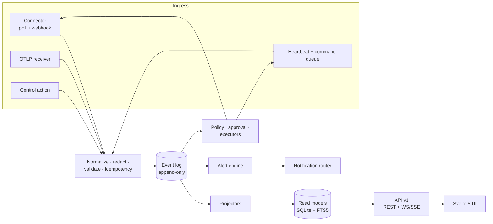

# Rizal Agent HQ v3 — Design

**Status:** DRAFT — menunggu approval. Tidak ada kode produk sebelum dokumen ini disetujui.
**Tanggal:** 2026-11-16
**Pemilik:** Rizal
**Menggantikan:** PRD v2 (2 November 2026) dan seluruh implementasi v2.x.
**Dokumen turunan:** `01-architecture.md`, `02-runtime-adapters.md`, `03-connectors.md`,
`04-control-plane.md`, `05-design-system.md`, `06-frontend.md`, `07-operations.md`,
`08-testing-gates.md`, `09-roadmap.md`, `sessions/S00..S26.md`.

---

## 1. Intent

Satu ruang kendali milik satu orang untuk semua agent AI yang bekerja untuknya:
apa yang sedang dikerjakan, apa yang butuh keputusan, dan berapa biayanya —
tanpa terminal, tanpa tersebar di banyak dashboard.

v2 membuktikan tiga hal: kantor 3D membuat agent terasa hadir, humanizer membuat
log bisa dibaca, dan collector nyata menghasilkan bukti yang dipercaya. v2 juga
menunjukkan batasnya: model snapshot 6 detik tidak punya sejarah, audit, replay,
atau jalur webhook; integrasi berhenti di tiga sumber; UI menjadi padat dan
penuh slop; aset bergantung pada CDN; kredensial tersimpan plaintext.

v3 menulis ulang total di repo yang sama: event log sebagai sumber kebenaran,
connector sebagai warga kelas satu, control plane dengan capability + audit,
UI Svelte 5 yang tenang dan presisi, kantor 3D yang benar-benar hidup.

## 2. Untuk siapa

Rizal, satu pengguna, di WSL2 + satu VM Muse, mengawasi 10+ runtime agent
sekaligus. Bukan SaaS, bukan multi-tenant, bukan aplikasi tim. Remote access
opsional lewat reverse proxy dengan device token.

## 3. Goals

1. **Satu sumber kebenaran berbasis event.** Setiap perubahan state dapat
   direplay, diaudit, dan ditelusuri sebab-akibatnya.
2. **Integrasi nyata, bukan placeholder.** Setiap connector punya auth, retry,
   rate limit, health, test, dan dokumentasi. Yang butuh kredensial punya live
   smoke opsional; yang tidak, diuji terhadap fake server.
3. **Kendali yang aman.** Aksi pada agent hanya lewat capability grant, policy,
   dan audit. Default deny untuk aksi destruktif.
4. **Bukti yang dipertahankan.** Rewrite collector divalidasi terhadap binary v2
   sebagai oracle paritas, bukan diasumsikan lebih baik.
5. **UI yang tenang dan presisi.** Satu aksen, satu ikon set, satu primary per
   layar, kontras AA, keyboard-first, reduced motion.
6. **Kantor 3D yang hidup.** Diorama isometrik dengan karakter, pathfinding,
   animasi status, dan objek yang menampilkan data nyata.
7. **Satu binary, offline.** UI, font, ikon, dan model di-embed/di-cache lokal.
   Tidak ada CDN saat runtime.
8. **Operable.** Backup, restore, migrasi, doctor, retensi, dan rollback terbukti.

### Success criteria (terukur)

| Kriteria | Target |
|---|---|
| Paritas collector vs oracle v2 | v2 ⊆ v3 setelah alias; status cocok ≥90%; usage global ±15% pada jendela waktu sama |
| Migrasi data lama | 33.436 snapshot usage, 220 dokumen Notion, 102 ringkasan LLM, 5 alert state; jumlah dan hash sampel cocok |
| Refresh cycle p95 | < 250 ms |
| API `overview` p95 | < 100 ms pada 10k event/agent/hari |
| Alert → Telegram | < 5 detik dari event |
| UI lokal | LCP < 1,5 s; bundle awal < 350 KB gzip |
| Kantor 3D | 60 fps @ 40 agent di GPU terintegrasi; idle = render-on-demand |
| Aksesibilitas | WCAG AA untuk semua teks; navigasi keyboard penuh; reduced-motion |
| Rahasia | 0 secret ditemukan di DB/log pada corpus scan |
| Backup/restore | drill berhasil, data identik setelah restore |
| Connector | 100% punya test + manifest + dokumen auth |

## 4. Non-goals

- Multi-tenant, billing, onboarding publik.
- Aplikasi mobile native (PWA cukup).
- Mode membangun/mendekorasi kantor, simulasi kebutuhan karakter, multiplayer.
- Menjalankan shell bebas tanpa allowlist.
- Membeli/menjual saham atau memberi nasihat investasi.
- Melatih model; semua model pihak ketiga.
- gRPC OTLP di v1 (HTTP/protobuf + JSON dulu; gRPC di belakang feature flag).
- Kompatibilitas API v2. Cutover memakai port dan binary baru; UI lama tidak dipertahankan.

## 5. Anti-goals

- Dashboard yang butuh refresh manual.
- Integrasi yang hanya mengembalikan data contoh.
- Alert storm: satu masalah = satu alert, bukan sepuluh.
- Angka yang tidak bisa ditelusuri ke event asalnya.
- UI yang bisa ditukar dengan produk lain tanpa ada yang sadar.
- Klaim performa tanpa pengukuran.

## 6. Constraints

- Backend Rust; frontend Svelte 5 + SvelteKit (static) + TypeScript + Tailwind v4 + Threlte.
- Satu binary release; aset UI di-embed; tidak ada Node saat runtime.
- SQLite (bundled) + WAL; single writer; read pool.
- Default bind `127.0.0.1:8900`; loopback implisit, remote butuh device token.
- Offline-first; model embedding diunduh sekali dengan checksum.
- WSL2 + systemd user service; journald untuk log.
- Semua teks bebas melalui redaksi sebelum persist.
- Waktu disimpan UTC ms, ditampilkan Asia/Jakarta (dapat dikonfigurasi).
- i18n ID (default), EN, 中文; kalimat disimpan sebagai template + params,
  dirender per request, bukan disimpan sebagai teks jadi.

## 7. Approaches considered

### 7.1 Model state

| Opsi | Trade-off | Putusan |
|---|---|---|
| Event log + projection | Desain skema di depan; replay/audit/time-travel/webhook native | **Dipilih** |
| Snapshot polling + bus | Cepat; audit, dedup, history tetap tempelan | Ditolak |
| Actor mesh per agent | Isolasi kuat; state tersebar, audit lintas-agent rapuh | Ditolak |

### 7.2 Runtime connector

| Opsi | Trade-off | Putusan |
|---|---|---|
| Native Rust trait + engine deklaratif | Satu binary; integrasi baru tanpa kompilasi | **Dipilih** |
| Plugin WASM | Sandbox pihak ketiga; host ABI + toolchain | Ditunda (trait disiapkan) |
| Sidecar gRPC | Bahasa bebas; dua proses, packaging rapuh | Ditolak |

### 7.3 Arah visual

| Opsi | Dunia | Putusan |
|---|---|---|
| Instrumented, quiet, hangat | Meja operasi shift malam; grafit/pasir; cahaya sinyal | **Dipilih** |
| Studio arsitek terang | Off-white, kaca, kobalt, blueprint | Ditolak |
| Ledger teknis | Near-black/kertas, mono, hampir tanpa warna | Ditolak |

### 7.4 Layar rumah

| Opsi | Trade-off | Putusan |
|---|---|---|
| Home operasional, kantor 3D sebagai view | Jawaban harian cepat; 3D tetap punya panggung sendiri | **Dipilih** |
| Kantor 3D sebagai home | Diferensiasi terlihat; data operasional tenggelam | Ditolak |
| Split permanen | Dua-duanya setengah; tidak ada yang unggul | Ditolak |

## 8. Keputusan terkunci

| # | Keputusan | Nilai |
|---|---|---|
| K1 | Sasaran | Personal, single-user, local-first |
| K2 | Kedalaman | Rewrite 100%, termasuk collector; oracle v2 untuk paritas |
| K3 | Frontend | Svelte 5 + SvelteKit + TypeScript + Tailwind v4 + Threlte |
| K4 | State | Event log append-only + projection |
| K5 | Connector | Native Rust trait + engine deklaratif YAML/JSON + manifest |
| K6 | Arah visual | Instrumented, quiet, sedikit hangat |
| K7 | Home | Operasional; `/office` menjadi view 3D |
| K8 | Katalog connector | Tiga tier (native / preset deklaratif / generic) |
| K9 | Akses | Local-only default + device token opsional |
| K10 | Kontrol | Policy + approval + audit; aksi aman lengkap |
| K11 | Runtime agent | Semua: OMP, Cursor, Claude Code, Codex, Muse, Devin, Gemini CLI, OpenCode, Copilot, MCP |
| K12 | Knowledge | FTS5 + embedding lokal, fallback FTS |
| K13 | Kantor 3D | Sims-like terbatas: pathfinding, animasi, objek interaktif |
| K14 | Secret | File terenkripsi + master key 0600 + env override |
| K15 | Sesi | 27 sesi (S00–S26), 1–3 jam, satu gate per sesi |
| K16 | Urutan | Vertical slice: event log → Today nyata → breadth |
| K17 | Batas approval | Notifikasi pre-authorized per kanal; aksi agent/tool/connector/shell lewat capability + approval; MCP read-only default |
| K18 | Time-travel | Browser event + `as_of` per agent; as-of seluruh sistem bukan v1 |
| K19 | Retensi | Arsip setelah 90 hari, tidak pernah menghapus event sumber; audit/alert/action tetap hot |

### Call yang kuambil (bisa diveto)

- SQLite, bukan Postgres.
- API `/api/v1`; tidak ada kompatibilitas v2.
- Light default "day watch", dark "night shift".
- IBM Plex Sans + IBM Plex Mono, self-hosted subset.
- uPlot untuk time series; SVG untuk chart kecil.
- `rusqlite` bundled + migrasi SQL bernomor + `PRAGMA user_version`.
- Retensi: event operasional 90 hari, audit/alert/action selamanya, agregat selamanya.
- Repo sama, branch `overhaul/v3`; crate lama dihapus setelah S25 lulus.
- Binary tetap bernama `rizal-agent-hq`; subcommand `serve`, `doctor`, `migrate`,
  `replay`, `secret`, `backup`, `restore`, `parity`, `model`, `mcp`.
- Sistem tetap memakai port 8900 saat cutover; oracle v2 live di 8900 dan
  kandidat di 8901 selama uji paritas.

## 9. Arsitektur



### 9.1 Crate

| Crate | Tanggung jawab | Tidak boleh |
|---|---|---|
| `hq-core` | domain types, event envelope, invarian, capability, policy types | I/O, async runtime |
| `hq-store` | SQLite, migrasi, writer tunggal, projection, replay, FTS, backup | tahu HTTP |
| `hq-connectors` | trait, registry, supervisor, engine deklaratif, built-ins | tahu UI |
| `hq-control` | policy eval, approval, executor, audit | mengeksekusi tanpa grant |
| `hq-alerts` | rule engine, dedup, state machine, escalation | mengirim langsung tanpa router |
| `hq-humanize` | fakta → template + params; task lifecycle | menyimpan teks jadi |
| `hq-knowledge` | chunking, embedding lokal, hybrid search | HTTP, UI, menulis event |
| `hq-observe` | OTLP in/out, Prometheus, self-health, tracing | mengubah domain |
| `hq-mcp` | MCP client + server | melewati policy |
| `hq-api` | Axum, REST v1, WS/SSE, webhook ingress, OpenAPI, auth | logika domain |
| `hq-server` | binary, CLI, wiring, supervisor | logika yang bisa dites di crate lain |

### 9.2 Event

```rust
pub struct Event {
    pub seq: i64,                 // INTEGER PRIMARY KEY AUTOINCREMENT, urutan global
    pub id: Ulid,                 // id stabil, sortable
    pub event_ts_ms: i64,         // waktu sumber (UTC)
    pub ingest_ts_ms: i64,        // waktu diterima HQ (UTC)
    pub kind: EventKind,          // enum inti + ConnectorEvent generik
    pub subject: Subject,         // agent/session/connector/alert/system/usage-scope
    pub source: SourceId,         // connector id / local / legacy / user / automation
    pub schema_version: u16,
    pub correlation_id: Option<Ulid>,
    pub causation_id: Option<Ulid>,
    pub idempotency_key: Option<String>,
    pub payload: serde_json::Value, // tervalidasi skema kind+versi
}
```

Invarian:

1. Append-only; tidak ada `UPDATE`/`DELETE` lewat API. Retensi memindahkan baris
   ke `events_archive`, tidak menghapusnya.
2. `seq` monoton dari SQLite; dipakai kursor WS/SSE dan `?since=`.
3. `idempotency_key` unik per `(source, key)`; duplikat = no-op yang tercatat
   di `connector_runs`.
4. Payload divalidasi terhadap skema `kind` + `schema_version` sebelum append.
5. Event lama tidak diubah; perubahan skema memakai upcaster saat baca/replay.
6. Projection inti (agent, session, alert, approval) berjalan **dalam transaksi
   yang sama** dengan append — tidak ada read stale untuk state operasional.
   Projection turunan (FTS, embedding, agregat berat) lewat `outbox` +
   `projection_checkpoint`, eventual, dan lag-nya tampil di `/health`.
7. `hq replay --rebuild` berjalan offline atau ke tabel bayangan lalu swap;
   tidak pernah menulis ke `events`.
8. Redaksi berjalan sebelum append; event yang lolos tidak pernah berisi secret.
9. Setiap aksi kontrol menghasilkan minimal tiga event: requested, decided,
   executed/failed.
10. Task bukan event sumber; task adalah projection (lihat 9.2.2).

### 9.2.1 Identitas agent

Subject memakai id stabil, bukan nama tampilan:

- Runtime utama: `agent:omp`, `agent:cursor`, `agent:muse`.
- Instance/sesi: `agent:omp/session/<session_id>`,
  `agent:opencode/session/<id>`, `agent:mcp/<server>`.
- Worker: `agent:omp/worker/<session_id>` dengan `parent=agent:omp`.
- Workspace Cursor: `agent:cursor/workspace/<sha1(path)[..12]>`.
- Heartbeat eksternal: `agent:<slug>`; slug stabil, nama tampilan terpisah.
- Legacy: alias v2 (`omp`, `cursor`, `Muse`, `mcp`, `omp-workers-agg`) dipetakan
  di `identity_aliases` untuk migrasi dan paritas.

Penggabungan: satu instance = satu subject. Proses, transcript, dan usage dari
runtime yang sama digabung lewat `runtime_key` (keluarga + id sesi/workspace).
Dua sumber tidak pernah membuat dua agent bila `runtime_key` sama. Nama
tampilan boleh berubah; id tidak.

### 9.2.2 Task dan waktu

- Task adalah **projection deterministik** dari `session.*`, `log.recorded`,
  `usage.recorded`, dan fakta adapter. Tidak ada event `task.*`; rebuild
  menghasilkan task identik.
- `event_ts_ms` = waktu kejadian sumber; `ingest_ts_ms` = waktu masuk. Event
  terlambat (transcript ditemukan belakangan) tetap memakai `event_ts_ms`;
  projection memperbarui agregat pada jendela waktu yang terpengaruh.
- `/timeline` = penjelajah event + filter. Time-travel yang didukung:
  `GET /agents/:id?as_of=<ts>` dengan replay event agent itu dari checkpoint
  terdekat (bounded). As-of seluruh sistem bukan bagian v1.

### 9.3 Katalog event (ringkas)

| Grup | Event |
|---|---|
| Agent | `agent.observed` (hanya saat berubah), `agent.seen` (maks 1/5 menit/agent), `agent.status_changed`, `agent.disappeared` |
| Session | `session.started`, `session.updated`, `session.ended` |
| Task | *tidak ada* — projection deterministik dari session/log/usage |
| Log | `log.recorded` (template + params + raw opsional) |
| Usage | `usage.recorded` (per agent/sesi/model), `quota.observed`, `cost.estimated` |
| Alert | `alert.raised`, `alert.updated`, `alert.acknowledged`, `alert.snoozed`, `alert.resolved` |
| Control | `action.requested`, `action.approved`, `action.denied`, `action.executed`, `action.failed` |
| Connector | `connector.registered`, `connector.health_changed`, `connector.poll_completed`, `connector.auth_failed`, `connector.event` (generik) |
| Knowledge | `knowledge.page_synced`, `knowledge.page_quarantined`, `knowledge.promoted` |
| System | `system.health_observed`, `config.changed`, `secret.rotated` (tanpa nilai), `device.added`, `device.revoked`, `notification.sent` |
| Telemetry | `telemetry.metric`, `telemetry.trace`, `telemetry.log` (dari OTLP; disampling/agregasi) |

`connector.event` adalah jalur resmi untuk connector deklaratif: payload berisi
`{connector_id, event_type, subject_hint, data}`, divalidasi terhadap JSON Schema
di manifest. Projector memetakan `event_type` yang dikenal ke projection inti;
yang tidak dikenal tampil di timeline/detail sebagai key-value generik. Dengan
ini integrasi baru tidak butuh enum Rust baru.

### 9.4 Storage

- `events` (append-only): `seq INTEGER PRIMARY KEY AUTOINCREMENT`, `id TEXT UNIQUE`,
  indeks `(event_ts_ms)`, `(subject)`, `(kind)`, `(correlation_id)`,
  `UNIQUE(source, idempotency_key)`.
- `events_archive`: skema sama, tanpa indeks sekunder; tetap dibaca saat rebuild.
- Read model: `agents`, `sessions`, `tasks`, `task_steps`, `logs`, `logs_fts`,
  `alerts`, `alert_decisions`, `usage_minute`, `usage_daily`, `connectors`,
  `connector_runs`, `approvals`, `audits`, `knowledge_pages`, `knowledge_chunks`,
  `knowledge_fts`, `identity_aliases`, `devices`, `settings`,
  `projection_checkpoint`, `outbox`.
- Writer tunggal lewat channel `mpsc`; append + projection inti satu transaksi;
  pembaca memakai pool read-only.
- Migrasi SQL bernomor, forward-only, `PRAGMA user_version`; backup otomatis
  sebelum migrasi.
- Retensi: setelah 90 hari event operasional dipindah ke `events_archive`
  (bukan dihapus); audit/alert/action tetap di `events`. Kompaksi malam,
  `VACUUM` mingguan, checkpoint WAL.
- Volume: `agent.observed` hanya saat berubah; `agent.seen` maksimal 1/5 menit
  per agent; telemetry diagregasi per menit; trace sampling 10% (dapat diatur).
  Target < 20k event/hari.

### 9.5 API

Base `/api/v1`. JSON, gzip, request-id, rate limit.

| Grup | Endpoint |
|---|---|
| Today | `GET /overview` |
| Agents | `GET /agents`, `GET /agents/:id?as_of=<ts>`, `GET /agents/:id/{tasks,logs,usage,sessions,files}` |
| Tasks | `GET /tasks`, `GET /tasks/:id` |
| Alerts | `GET /alerts`, `POST /alerts/:id/{ack,snooze,resolve}` |
| Timeline | `GET /timeline`, `GET /events` |
| Usage | `GET /usage`, `GET /costs` |
| Connectors | `GET /connectors`, `POST /connectors/:id/{test,poll,enable,disable}`, `POST /connectors/:id/actions/:action` |
| Control | `GET /approvals`, `POST /approvals/:id/{approve,deny}`, `POST /actions`, `GET /agents/:id/commands`, `POST /agents/:id/commands/:cid/result` |
| Knowledge | `GET /knowledge/search`, `POST /knowledge/{sync,promote}` |
| Ingest | `POST /heartbeat`, `POST /ingest/otlp/v1/{metrics,traces,logs}`, `POST /webhooks/:connector` |
| Meta | `GET /metrics`, `GET /openapi.json`, `GET /health`, `GET /doctor` |
| Live | `GET /ws`, `GET /events/stream` |

Auth:

- Default bind loopback, `HQ_TRUST_LOOPBACK=1`: peer loopback = owner.
- Remote: `HQ_TRUST_LOOPBACK=0`. Semua request, termasuk dari reverse proxy,
  wajib `Authorization: Bearer` atau cookie sesi. `X-Forwarded-For` tidak pernah
  membuat request dipercaya; bila header itu muncul saat trust loopback aktif,
  request ditolak (fail closed).
- Token disimpan sebagai hash + scope + expiry. `hq device add` membuat kode
  pairing sekali pakai.
- Cookie `HttpOnly; SameSite=Strict; Secure` saat HTTPS; mutasi wajib
  `X-CSRF-Token` (double-submit). Setiap aksi kontrol dicek capability.
- WS tidak bisa membawa `Authorization` dari browser: `POST /auth/ws-ticket`
  (cookie) → tiket sekali pakai 60 detik → `GET /ws?ticket=...&since=...`.

WebSocket: `hello {seq}`, `patch {seq, entities}`, `alert`, `action`; klien
reconnect dengan `?since=seq`. `seq` adalah `events.seq`, bukan counter patch,
sehingga snapshot + since bebas gap. Server menyimpan ring buffer 1000 patch;
`since` yang lebih lama dari ring atau retensi → snapshot penuh.

## 10. Runtime adapter — bukti per agent

Setiap adapter mendeklarasikan level bukti dan kanal kontrol. UI menampilkan
badge bukti hanya di detail, bukan di overview.

| Runtime | Bukti | Level | Kontrol |
|---|---|---|---|
| OMP | proses, sesi/transcript, `omp stats`, usage | L3 | prompt CLI, tmux, sinyal |
| Cursor | proses server/agent, aktivitas workspace, state lokal | L2 | buka workspace; tidak ada API chat |
| Claude Code | `~/.claude` transcript, proses | L3 | CLI prompt, sinyal |
| Codex | `~/.codex` rollout, proses | L3 | CLI exec, sinyal |
| Muse | heartbeat, Tailscale | L2 | command queue |
| Devin | API cloud (kunci) | L2 | API action |
| Gemini CLI | sesi lokal, proses | L2 | CLI prompt |
| OpenCode | storage lokal, proses | L2 | CLI run |
| Copilot | proses/CLI, GitHub API usage | L1–L2 | CLI jika tersedia |
| MCP server | proses, config, health handshake, tools | L3 | MCP tool call |
| Heartbeat generik | POST + last-seen | L1–L2 | command queue |

Level: L1 keberadaan proses, L2 sesi/transcript, L3 usage terstruktur,
L4 kanal kontrol penuh. Adapter yang hanya L1 tidak boleh menampilkan klaim
task yang tidak ada buktinya; statusnya "Offline" atau "Santai" dengan
catatan bukti terbatas.

**Terverifikasi di mesin ini (2026-11-16):** binary `omp`, `cursor` (Windows),
`cursor-agent`, `opencode`, `copilot` (shim VS Code), `gh`, `tmux`, `docker`,
`git`, `tailscale` tersedia. `claude`, `codex`, `gemini` tidak ada sebagai
binary, tetapi direktori konfigurasi/sesi ada (`~/.claude` 912K, `~/.codex`
12K, `~/.gemini` 78M) — adapter harus jujur: konfigurasi saja bukan bukti
aktivitas. Sumber bukti besar: `~/.omp` 2,9G, `~/.cursor` 589M,
`~/.local/share/opencode` 823M (berisi `opencode.db`), `~/.config/opencode`
59M. Artinya OpenCode punya bukti L3 berbasis SQLite, Cursor L2, dan OMP L3.
Devin belum terverifikasi (butuh kunci API); statusnya `unconfigured` sampai
kunci ada.

**Constraint build:** `pnpm` saat ini hanya ada lewat path Windows
(`/mnt/d/laragon/...`). S00 wajib memasang pnpm di WSL (corepack) dan
mengunci versi; build tidak boleh bergantung pada Node Windows.

**Oracle paritas:** S00 membekukan (a) binary v2 dan unit systemd asli,
(b) 200 sampel `/api/state` selama 20 menit beserta timestamp, (c) bukti mentah
pada saat yang sama (`ps`, `omp stats`, listing file sesi). Sampel beku adalah
fixture untuk menguji normalizer dan humanizer, bukan pengganti perbandingan
live. Uji yang mengikat: oracle v2 live di 8900, kandidat di 8901, host sama,
sampling simultan 10 menit. Perintah:
`hq parity --oracle http://127.0.0.1:8900 --candidate http://127.0.0.1:8901`.
Gerbang: setiap agent v2 punya padanan v3 setelah alias mapping (v2 ⊆ v3);
agent tambahan hanya boleh muncul bila ada bukti runtime; status ≥90% untuk
agent yang berpasangan; usage global ±15%; alert fingerprint sama. S09/S10
memakai harness yang sama dengan subset agent; S25 menjalankan versi penuh.

## 11. Connector

### 11.1 Trait

```rust
#[async_trait]
pub trait Connector: Send + Sync {
    fn manifest(&self) -> &Manifest;
    async fn poll(&self, ctx: &ConnectorCtx<'_>) -> Result<Vec<EventDraft>, ConnectorError>;
    async fn handle_webhook(&self, req: WebhookRequest) -> Result<Vec<EventDraft>, ConnectorError>;
    async fn action(&self, action: &str, input: Value) -> Result<ActionOutcome, ConnectorError>;
    async fn health(&self) -> Health;
}
```

Manifest: id, nama, tier, ikon (SVG path), auth kinds, scopes, event kinds,
actions, rate limit, dokumentasi. Supervisor per connector: backoff + jitter,
circuit breaker, `next_run_at`, `last_error`, health event.

### 11.2 Engine deklaratif

Satu file YAML mendefinisikan: meta, auth (none/bearer/basic/api-key/OAuth2
client-credentials/authorization-code), poll (URL, pagination, JSONPath mapping),
webhook (verifikasi HMAC/header/timestamp/nonce), actions (HTTP template),
retry/rate limit. Rahasia dirujuk sebagai `${secret:path}`, tidak pernah
diserialisasi. Ini yang membuat "integrasi ke mana-mana" benar tanpa PR Rust.

### 11.3 Katalog

| Tier | Connector | Bukti |
|---|---|---|
| 1 native | GitHub, Telegram, MCP client+server, OTLP, Prometheus, Notion, EODHD/FMP, heartbeat, collector lokal, adapter runtime | tipe Rust + test + live smoke opsional |
| 2 preset | Slack, Discord, WhatsApp Cloud, Linear, Jira, Sentry, Home Assistant, Google Calendar, email/SMTP, ntfy, generic webhook in/out, PagerDuty, Teams, Lark, Mattermost, Gotify, Pushover, Twilio, Resend, Vercel, Cloudflare, RSS, Docker API | YAML tervalidasi + fake-server test + dokumen auth |
| 3 generic | HTTP pull/push + mapping, MCP client untuk server apa pun | engine yang sama |

Tidak ada connector yang dihitung "selesai" tanpa manifest, test, dan
dokumentasi auth. Connector tanpa kredensial berjalan dalam status
`unconfigured`, bukan menampilkan data palsu.

### 11.4 Secret

`~/.config/rizal-agent-hq/secrets.age` (age/XChaCha20), master key file 0600,
override env untuk CI. CLI `hq secret set|list|rm|rotate`; nilai tidak pernah
masuk log, event, atau error message. Redaksi punya corpus uji (API key, JWT,
private key, password, connection string, high-entropy) dan tidak boleh
memotong git hash/UUID.

## 12. Control plane

### 12.0 Aktor dan efek samping

| Aktor | Identitas | Wewenang |
|---|---|---|
| owner | UI loopback / device token scope `owner` | semua capability |
| automation:<rule> | scheduler / alert rule | `notification.send` + aksi yang dideklarasikan rule dan diizinkan policy; tidak bisa mengubah policy |
| agent:<id> | token agent eksternal | heartbeat + hasil command; tidak bisa membaca agent lain |
| system | startup / migrasi | health + config internal; tidak bisa aksi pada agent |

- Notifikasi keluar tidak butuh approval per pesan; kanal harus diaktifkan owner
  lewat config, dan setiap kiriman menjadi event `notification.sent`.
- Aksi pada agent/tool/connector/shell selalu capability; `require_approval`
  bila policy menentukan.
- MCP server HQ read-only secara default. Tool kontrol hanya untuk device token
  dengan scope `mcp.control`, dan tetap lewat approval.
- Perubahan policy butuh konfirmasi frasa owner + audit; bukan antrean approval
  karena owner adalah approver.
- Automation tidak bisa menaikkan scope dirinya sendiri.

### 12.1 Capability

`agent.prompt`, `agent.pause`, `agent.resume`, `agent.stop`, `tool.approve`,
`tool.deny`, `connector.action`, `shell.run:<name>`, `config.write`,
`device.manage`.

### 12.2 Policy

```yaml
default: deny
rules:
  - allow: [agent.prompt]
    when: { agent: [omp, muse], actor: owner }
  - require_approval: [agent.stop, connector.action]
  - allow: [shell.run:git-status]
  - deny: [shell.run:rm]
```

Evaluasi deterministik, dites sebagai tabel kasus. Aksi destruktif butuh
konfirmasi eksplisit dan menampilkan argv/HTTP request persis.

### 12.3 Approval

Queue persisten; nonce; kedaluwarsa 15 menit; kanal UI + Telegram inline;
keputusan dan eksekusi menjadi event audit. Approval yang kedaluwarsa =
denied, bukan dilupakan.

### 12.4 Executor

| Target | Mekanisme | Batas |
|---|---|---|
| OMP | CLI prompt / tmux send-keys / sinyal | timeout 120 s, output capture |
| Proses tersupervisi | start/stop/restart unit/systemd user | tanpa shell |
| MCP | tool call via client | timeout, schema-validated |
| Agent eksternal | command queue + long-poll | signed token, idempoten |
| HTTP connector | action template | rate limit, retry |
| Shell | argv allowlist, tanpa shell interpolation | cwd tetap, env minimal |

### 12.5 Threat model

| Ancaman | Mitigasi |
|---|---|
| Secret bocor ke log/DB | redaksi sebelum persist + corpus + scan gate |
| Webhook palsu | HMAC + timestamp + nonce + replay window |
| Token remote dicuri | hash, scope, expiry, rate limit, revoke |
| Prompt injection dari konten agent | konten = data, tidak pernah dieksekusi; aksi butuh intent eksplisit |
| Shell injection | argv array, allowlist, tanpa `sh -c` |
| Replay aksi | idempotency key + nonce + approval expiry |
| Akses lokal jahat | bind loopback, file 0600, enkripsi secret, audit |
| Supply chain | lockfile, `cargo-deny`, `cargo-audit`, pnpm `ignore-scripts` |

## 13. Design system

### 13.1 Arah (unslop)

- **Product:** ruang kendali satu orang untuk setiap agent AI — apa yang
  dikerjakan, apa yang butuh keputusan, berapa biayanya.
- **Character:** instrumented, quiet, a little warm.
- **World:** meja operasi shift malam — grafit hangat, netral pasir, cahaya
  sinyal sebagai satu-satunya warna; permukaan putih kertas saat siang.
- **Moments:** (1) `/office` sebagai diorama arsitektur yang benar-benar
  diterangi; (2) `/` ledger live dengan angka presisi dan attention rail.
- **Signature:** **attention rail** — satu tepi tetap tempat semua yang butuh
  kamu mendarat, posisi sama di setiap layar inti.
- **Bukan:** gradient ungu/biru, glow, emoji sebagai ikon, pill soup, label
  uppercase ber-tracking, badge "New ✨", angka tanpa satuan.

### 13.2 Token

| Peran | Light | Dark |
|---|---|---|
| ground | `#F4F1EA` | `#0C0C0B` |
| surface | `#FFFFFF` | `#151514` |
| surface raised | `#FFFFFF` + ring | `#1D1D1B` |
| well | `#ECE8DF` | `#101010` |
| hairline | `rgba(23,22,20,.10)` | `rgba(242,239,233,.12)` |
| ink-12 | `#171614` | `#F2EFE9` |
| ink-11 | `#55514A` | `#B5B0A7` |
| ink-10 | `#6F6A62` | `#8E8980` |
| attention | `#A65A00` | `#F2A63C` |
| attention tint | `#FCEBD6` | `#3A2A12` |
| critical | `#B3261E` | `#FF6B5E` |
| success | `#1B6B45` | `#4CC38A` |
| info | `#245C8A` | `#6FA8DC` |

Kontras terukur: teks/ground 16,03:1; sekunder/ground 6,99:1; muted/ground
4,76:1; attention/ground 4,56:1; primary button 16,60:1. Semua pasangan teks
≥4,5:1. Satu aksen (attention) tidak pernah mengisi tombol; primary = ink-12.
Semantik hanya untuk status dan hasil.

### 13.3 Tipe dan bentuk

IBM Plex Sans 400/500/600; IBM Plex Mono 400/500 untuk angka, ID, kode.
Body 13/20; meta 12/16; judul kartu 16/24; seksi 20/28; display 32/40 −0,02em;
`tabular-nums` di semua angka. Sentence case, tanpa italic, tanpa uppercase
ber-tracking. Radius 6 kontrol, 8 kartu, 12 modal; grid 4px; gutter 24–32.
Shadow hanya ring + drop 1px (crisp), tanpa blur besar. Satu kurva
`cubic-bezier(.23,1,.32,1)`, 150–300 ms, reduced-motion mengganti travel
dengan crossfade.

### 13.4 Komponen inti

Button (primary/secondary/ghost/destructive), Input+Field, Select, Tabs,
Table, StatusDot, Badge, AttentionRail, AgentMonogram, LedgerChart,
Drawer/Sheet, Modal, Toast, CommandPalette, EmptyState, Skeleton, Keycap.
Ikon lucide 16/18px, stroke 1.5, satu warna per peran teks.

## 14. Frontend

SvelteKit + `adapter-static`, `ssr=false`, Svelte 5 runes, TS strict,
Tailwind v4 dengan token CSS, Threlte, uPlot, lucide-svelte. Asset di-embed
via `rust-embed`; build CI membutuhkan Node, runtime tidak.

| Route | Isi |
|---|---|
| `/` | attention rail, strip KPI, tabel agent, ledger live, biaya |
| `/agents/[id]` | summary, tasks, log + raw toggle, usage, sessions/files, kontrol |
| `/office` | diorama 3D, status, klik-fokus, fallback 2D |
| `/timeline` | event stream, filter, replay/time-travel |
| `/alerts` | open/history, ack/snooze, escalation |
| `/automations` | approval queue, audit, policy editor; rule/quiet hours di file |
| `/integrations` | connector, health, secret, action, manifest |
| `/knowledge` | search, page, promote |
| `/costs` | cash vs shadow per agent/model/provider |
| `/markets` | watchlist + portfolio read-only; tanpa nasihat |
| `/settings` | retensi, tema, bahasa, backup, device |

State: klien API typed dari OpenAPI; store rune; patch WS; cache dengan
invalidasi berbasis event; optimistic hanya untuk ack/snooze. Tidak ada
library state global tambahan.

### 14.1 Kantor 3D

- Satu lantai, 6 zona, maksimal 40 agent terlihat; sisanya agregat "+N".
- Nav grid 0,5 m, A* + steering avoidance; karakter primitif low-poly
  (manusia untuk utama, robot untuk worker/MCP) dengan animasi prosedural:
  idle, mengetik, berpikir, menunggu, tidur, error, berjalan, rapat.
- Objek interaktif membawa data nyata: papan putih = task hari ini, papan
  alert = alert terbuka, rak server = MCP, meja rapat = approval queue.
- Lighting warm key + fill; day/night mengikuti WIB; tanpa glow/neon.
- Kamera isometrik ortho default, preset, follow agent; render-on-demand;
  fallback 2D floor plan; reduced-motion mematikan walk cycle.
- Bukan game: tanpa build mode, needs, kustomisasi karakter, multiplayer.

### 14.2 Performance budget

Bundle awal < 350 KB gzip; chunk 3D dimuat hanya di `/office`; LCP < 1,5 s
lokal; WS patch < 4 KB tipikal; chart ≤ 2 chart per layar (satu utama).

## 15. Operasi

- XDG: config `~/.config/rizal-agent-hq/`, data
  `~/.local/share/rizal-agent-hq/`; env override untuk dev.
- Instalasi tetap mendukung `~/rizal-agent-hq` + systemd user unit; installer
  memigrasikan data lama.
- `hq doctor`: integritas DB, ukuran WAL, lag event, health connector,
  dekripsi secret, model, port, disk, systemd.
- `hq backup` (online backup + config), `hq restore`, drill di gate.
- Migrasi forward-only; backup otomatis sebelum migrasi; rollback = restore
  backup + binary lama.
- Observability: tracing JSON ke journald; `/metrics`; OTLP export opsional;
  halaman self-health; metrik lag event, latency connector, klien WS.
- Retensi: operasional 90 hari, audit selamanya, agregat selamanya; kompaksi
  malam; `VACUUM` mingguan.

## 16. Migrasi data v2

| Sumber v2 | Tujuan v3 | Verifikasi |
|---|---|---|
| `snapshots` 33.436 baris | event `usage.recorded` sintetis, subject `usage:global`, `source=legacy`, `attribution=global` | jumlah baris = jumlah event; sampel 20 hash payload; total global sama |
| `notion_docs` 220 | `knowledge_pages` + event `knowledge.page_synced` | jumlah, `content_hash` sampel, 20 query FTS top-1 sama |
| `notion_sources` 3 | config connector Notion | id + root page sama |
| `llm_summaries` 102 | tabel cache `summaries` | jumlah + hash kunci |
| `alert_state` 5 | event `AlertAcknowledged` dengan subject `alert:legacy:<id>` + payload legacy | 5 event; payload `legacy_id`/`state`/`updated_ms`; tidak ada alert v2 dibawa sebagai open karena id v2 tidak memetakan ke fingerprint v3 |
| `heartbeats/*.json` | event `AgentSeen` (`source=heartbeat`) | agent + last-seen |
| `stocks.json`, `notion.json` | config connector | simbol + source sama |
| `portfolio_snapshots` 0 | tidak ada | — |

Selama migrasi, oracle v2 tetap hidup di 8900; kandidat di 8901 dengan
salinan DB. Cutover hanya setelah laporan paritas + migrasi lulus, dan
rollback diuji (restore backup + start unit lama).

Legacy usage tidak punya agent id. Riwayat biaya per-agent karena itu dimulai
saat cutover; paritas hanya membandingkan total global (legacy vs agregat
collector baru), bukan atribusi per-agent historis. Ini batasan yang dinyatakan,
bukan angka yang dikarang.

## 17. Testing dan gate

| Lapis | Isi | Gate |
|---|---|---|
| Unit | invarian domain, policy table, redaksi, humanizer golden, upcaster | `cargo test` hijau, corpus 100% |
| Parity | oracle v2 vs kandidat pada data nyata | set agent, status, usage, alert |
| Contract | OpenAPI schema + klien TS compile | `hq openapi --check` |
| Integration | SQLite temp + fake HTTP server per connector | setiap connector |
| E2E | Playwright terhadap binary nyata + fixture event | alur Today, detail, office, approval |
| Visual | snapshot komponen + kedua tema + zoom | tidak ada regresi |
| A11y | axe + keyboard + kontras | 0 violation serius |
| Perf | refresh, API, WS, bundle, 3D | budget §14.2 |
| Security | authz, CSRF, signature, secret scan, cargo-deny | 0 temuan kritis |

Setiap sesi berakhir dengan gate-nya sendiri; gate global hanya di S25–S26.

## 18. Roadmap

27 sesi, 1–3 jam. Vertikal slice lebih dulu: event log → Today nyata →
breadth. Detail langkah ada di `sessions/`.

| Sesi | Isi | Bergantung |
|---|---|---|
| S00 | Fondasi: branch, workspace, CI, ADR, oracle + fixture paritas | — |
| S01 | Domain, katalog event, upcaster, redaksi v2 | S00 |
| S02 | Store, migrasi, writer, projection, replay, backup | S01 |
| S03 | Ingest, idempotency, bus, WS/SSE | S02 |
| S04 | Collector sistem: proses, tmux, git, docker, sistem | S03 |
| S05 | Humanizer + task lifecycle + i18n template | S04 |
| S06 | API v1, OpenAPI, klien typed, auth | S05 |
| S07 | Design system + shell + palette + i18n UI | S06 |
| S08 | Today: KPI, tabel agent, ledger, attention rail | S07 |
| S09 | Collector runtime A: OMP, Cursor, Muse + paritas | S04, S05 |
| S10 | Collector runtime B: Claude, Codex, Gemini, OpenCode, Copilot, Devin, MCP + paritas | S09 |
| S11 | Alert engine, dedup, escalation, quiet hours | S08 |
| S12 | Agent detail: tabs, log raw, usage, sessions/files | S11 |
| S13 | Office core: scene, layout, kamera, render-on-demand | S07 |
| S14 | Office karakter: nav grid, pathfinding, animasi | S13 |
| S15 | Office interaktif: objek data nyata, 2D fallback, perf | S14 |
| S16 | Timeline, replay, knowledge search + embedding lokal | S06 |
| S17 | Connector framework, engine deklaratif, secret | S03, S06 |
| S18 | GitHub connector | S17 |
| S19 | Telegram connector | S17 |
| S20 | MCP client + server | S10, S17 |
| S21 | OTLP + Prometheus + self-health | S03, S06 |
| S22 | Preset batch 1: Slack, Discord, WhatsApp, email, ntfy, webhook | S17, S19 |
| S23 | Preset batch 2: Linear, Jira, Sentry, HA, Calendar, lainnya | S17, S19 |
| S24 | Control plane: capability, policy, approval, audit UI | S11, S12, S17, S19 |
| S25 | Migrasi data, paritas, cutover, rollback drill | semua inti |
| S26 | Hardening: perf, security, a11y, backup/restore, rilis | S25 |

**Milestone terlihat:** S08 = Today hidup dengan data nyata; S12 = detail
lengkap; S15 = kantor 3D baru; S23 = seluruh katalog connector; S25 = cutover.

## 19. Risiko

| Risiko | Dampak | Mitigasi |
|---|---|---|
| Regresi akurasi collector | Bukti salah, kepercayaan hilang | oracle paritas + fixture + gate S25 |
| Scope creep 3D | Sesi membengkak | batas tegas §14.1; bukan game |
| Auth connector beragam | Integrasi setengah jadi | engine deklaratif + test per connector + status unconfigured jujur |
| Skema event berubah | Migrasi mahal | `schema_version` + upcaster + replay test |
| SQLite writer contention | UI lambat | writer tunggal + read pool + WAL + indeks terukur |
| Secret handling | Kebocoran | enkripsi + redaksi + scan gate + audit |
| Kelelahan 27 sesi | Proyek berhenti | vertical slice + milestone terlihat tiap fase |
| Oracle hilang | Paritas tak bisa diuji | binary + fixture dibekukan di S00, disimpan di repo tools |

## 20. Yang diserahkan ke builder

- ID model embedding final (target: multilingual-e5-small, 384 dim, ONNX)
  beserta sumber unduhan + checksum.
- Apakah OTLP gRPC masuk v1 (default: tidak, HTTP/protobuf + JSON).
- Subset font dan daftar glyph yang di-embed.
- Ambang default alert (menunggu > 15 menit, disk ≥ 90%, kuota ≥ 90%/100%).
- Bentuk tanda tangan token command queue agent eksternal (HMAC vs bearer
  scoped) dan masa berlakunya.
- Bentuk akhir manifest connector (field wajib vs opsional) setelah S17.

## 21. Resolusi builder check

| # | Pertanyaan | Keputusan | Letak |
|---|---|---|---|
| 1 | Konsistensi projection | append + projection inti sinkron; turunan async lewat outbox; `seq` = `events.seq`; rebuild offline/shadow | §9.2, §9.4, §9.5 |
| 2 | Identitas agent | subject stabil + `runtime_key` + alias v2 | §9.2.1 |
| 3 | Event connector generik | enum inti + `connector.event` + JSON Schema manifest; render generik | §9.3, §11.2 |
| 4 | Waktu, late events, time-travel | `event_ts` vs `ingest_ts`; as-of per agent; timeline = browser | §9.2.2 |
| 5 | Retensi dan volume | arsip, bukan hapus; dedupe + sampling; < 20k event/hari | §9.4 |
| 6 | Task | projection deterministik, bukan event | §9.2.2 |
| 7 | Usage | payload per agent/sesi/model; legacy = total global | §9.3, §16 |
| 8 | Auth proxy dan WS | trust loopback fail-closed; token mode; ws ticket sekali pakai | §9.5 |
| 9 | Aktor dan efek samping | owner/automation/agent/system; notifikasi pre-authorized; MCP read-only default | §12.0 |
| 10 | Ground truth paritas | freeze binary + fixture; live concurrent 8900/8901 yang mengikat | §10 |
