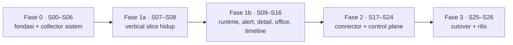

# 09 — Roadmap, Cutover, Risiko

Indeks sesi ada di [`README.md`](README.md) §4. Dokumen ini menjelaskan urutan,
gerbang antar-fase, runbook cutover, dan cara berhenti dengan aman.

## 1. Fase

| Fase | Sesi | Hasil yang bisa dilihat | Gerbang fase |
|---|---|---|---|
| 0 | S00–S06 | event log, collector sistem, humanizer, API | S06 gate + API nyata |
| 1a | S07–S08 | Today hidup dari data nyata | E2E + LCP |
| 1b | S09–S16 | semua runtime, alert, detail, office 3D, timeline | paritas + 3D budget |
| 2 | S17–S24 | connector nyata, Telegram, GitHub, MCP, OTLP, control plane | tiap connector punya test + manifest |
| 3 | S25–S26 | data lama pindah, cutover, rilis v3.0.0 | paritas + rollback drill |

Aturan urutan:

- S08 tidak boleh dimulai sebelum S06; UI tidak dibangun di atas data palsu.
- S09/S10 tidak boleh dimulai sebelum S05; adapter memakai humanizer.
- S11 tidak boleh dimulai sebelum S08; alert butuh read model Today.
- S17 tidak bergantung pada UI; boleh dikerjakan paralel hanya jika S08 lulus.
- S24 tidak boleh dimulai sebelum S19; approval butuh kanal Telegram.
- S25 adalah gerbang tunggal; tidak ada cutover bertahap.

## 2. Milestone

| Milestone | Sesi | Bukti |
|---|---|---|
| M0 Kontrak | S00–S02 | CI hijau, rebuild identik, oracle beku |
| M1 Hidup | S08 | Today menampilkan agent nyata, attention rail |
| M2 Akurat | S10 | paritas v2 ⊆ v3, status ≥90% |
| M3 Terkendali | S12 + S11 | alert, detail, ack dari UI |
| M4 Hadir | S15 | kantor 3D Sims-like terbatas, 2D fallback |
| M5 Terhubung | S23A–C | katalog connector lengkap, status jujur |
| M6 Aman | S24A–B | deny default, approval, audit |
| M7 Rilis | S25–S26 | cutover + v3.0.0 |

## 3. Runbook cutover (S25)

### 3.1 Preflight

- [ ] S00–S24 gate hijau; tag `s24-done` ada.
- [ ] `tools/parity` siap; oracle v2 + fixture utuh (checksum cocok).
- [ ] Backup v2 terbaru bisa direstore (drill, bukan asumsi).
- [ ] Disk ≥ 2× ukuran DB + WAL; `hq doctor` bersih.
- [ ] Secret v2 sudah dimigrasikan ke `secrets.age`; tidak ada plaintext di unit.
- [ ] Unit systemd v3 disiapkan, port tetap 8900.

### 3.2 Migrasi ke salinan

1. `hq backup --from ~/rizal-agent-hq/data/hq.db --out backups/v2-<ts>.db`
2. `hq migrate --from backups/v2-<ts>.db --to shadow/hq.db`
3. Verifikasi otomatis: jumlah snapshot 33.436, notion 220, ringkasan 102,
   alert state 5, hash sampel, 20 query FTS top-1.
4. Start kandidat: `HQ_PORT=8901 HQ_DATA=shadow hq serve`.
5. Parity 10 menit + smoke checklist (overview, detail, ack, WS, connector test,
   approval dry-run).
6. Tulis `tools/parity/report-<ts>.md` + `docs/overhaul/evidence/S25.md`.

### 3.3 Switch

1. `systemctl --user stop rizal-agent-hq` (v2).
2. Ganti binary + unit + config ke v3; `HQ_DATA` menunjuk DB hasil migrasi.
3. `systemctl --user start rizal-agent-hq`; cek `/health`, `/overview`, `/ws`.
4. Verifikasi satu alert sungguhan sampai ke Telegram; satu approval ditolak
   dan satu disetujui (dry-run target).
5. Biarkan backup v2 + binary v2 tersedia 7 hari.

### 3.4 Rollback

- Stop v3, restore unit + binary v2, start v2 dengan DB asli yang tidak pernah
  ditulis (migrasi hanya membaca salinan).
- Data yang dibuat v3 setelah switch hilang; catat di insiden. Jangan menyalin
  balik event v3 ke v2.
- Rollback drill wajib dilakukan sekali sebelum switch, bukan setelah gagal.

### 3.5 Setelah switch

- Hapus crate dan `web/` lama setelah 24 jam tanpa regresi; perbarui README,
  CHANGELOG, screenshot, dan release notes.
- Jalankan `hq doctor` + backup pertama; verifikasi retensi dan kompaksi.
- Pantau 24 jam: event lag, connector health, alert volume, RSS, disk.

## 4. Risiko dan pemicu berhenti

| Risiko | Pemicu | Tindakan |
|---|---|---|
| Paritas gagal | status < 90% atau usage > 15% | jangan cutover; perbaiki adapter; ulang S09/S10 |
| 3D tidak mencapai budget | < 55 fps @ 40 agent | kurangi agent terlihat, matikan bayangan, pertahankan 2D |
| Connector auth tidak bisa diuji | tidak ada kredensial | kirim `unconfigured` + docs; jangan data palsu |
| Volume event meledak | > 20k/hari | perketat dedupe/sampling; ukur ulang sebelum lanjut |
| Sesi melewati 3 jam | gate belum lulus | berhenti, tulis `sessions/NOTES.md`, pecah sesi |
| Disk menipis | < 20% bebas | arsip/kompaksi, pindahkan backup, tunda model embedding |
| Secret bocor | scan menemukan | rotasi, purge DB/log, catat insiden, ulangi gate |
| Scope creep | fitur di luar design | tunda ke `sessions/NOTES.md`; jangan masukkan sesi |

## 5. Guardrail scope

- Tidak ada fitur baru di luar `00-design.md` selama sesi. Ide baru masuk
  `sessions/NOTES.md` untuk setelah v3.
- Tidak ada dependency baru tanpa memperbarui `01-architecture.md`.
- Tidak ada endpoint tanpa OpenAPI + regenerasi klien.
- Tidak ada komponen UI di luar design system.
- Tidak ada connector dianggap selesai tanpa manifest + test + dokumen auth.
- Tidak ada klaim performa tanpa angka yang diukur dan disimpan.

## 6. Definisi rilis v3.0.0

Rilis hanya jika semua ini ada:

- [ ] `cargo test --workspace`, clippy, fmt, deny hijau.
- [ ] `pnpm check`, `test`, `build`, Playwright hijau.
- [ ] Parity report `PASS` + migrasi terverifikasi.
- [ ] Backup/restore drill berhasil.
- [ ] A11y 0 serious/critical; kontras terukur.
- [ ] Bundle + LCP + 3D budget terukur dan dicatat.
- [ ] Tidak ada secret di DB/log corpus scan.
- [ ] README, CHANGELOG, screenshot, install script, systemd, tarball + checksum.
- [ ] Rollback terdokumentasi dan diuji.

## 7. Setelah v3.0.0

Kandidat berikutnya, tidak masuk scope sekarang: OTLP gRPC, host plugin WASM,
as-of seluruh sistem, aplikasi mobile native, multi-user/RBAC, dan connector
pihak ketiga di luar katalog.
